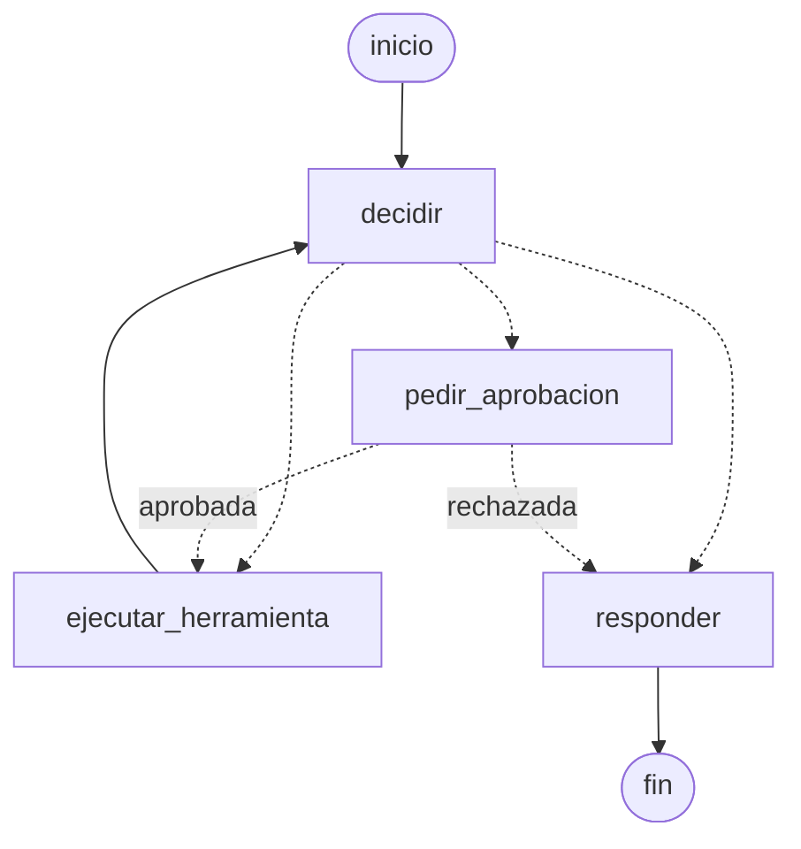

# Agente supervisado · Pre-Entrega 4 (ejemplo)

Proyecto de ejemplo para la **Pre-Entrega 4: Agente con LangGraph, MCP y aprobación humana**
del curso Forward Deployed Engineer.

**Caso ficticio:** soporte de pedidos de la *Distribuidora Los Andes*. El agente responde
consultas sobre pedidos y políticas, y puede **reprogramar entregas**, pero solo si una
persona lo aprueba.



## Qué cubre de la consigna

| Requisito | Dónde está |
|---|---|
| Grafo con estado `mensajes`, `usuario`, `pasos`, `pendiente_aprobacion` | `agente/estado.py` |
| Nodos decidir, ejecutar herramienta, pedir aprobación y responder | `agente/grafo.py` |
| Bucle con límite configurable y mensaje claro al llegar al máximo | `MAX_PASOS` en `config.py`, nodo `decidir` |
| Estado persistente: interrumpir y retomar con el mismo `thread_id` | `SqliteSaver` en `agente/grafo.py`, `chat.py --thread` |
| Aprobación humana con `interrupt` (caminos aprobado y rechazado) | nodo `pedir_aprobacion` |
| Servidor MCP propio, ≥ 2 herramientas tipadas (lectura y escritura) | `servidor_mcp/server.py` |
| Script cliente que lista herramientas y llama a una | `servidor_mcp/probar_cliente.py` |
| Sistema del cliente simulado (SQLite con datos ficticios) | `sistema_cliente/seed.py` |
| `buscar_documentos` (tu RAG) como herramienta | `agente/rag.py` |
| 5 conversaciones de ejemplo con traza | `run_demo.py` → `docs/conversaciones/` |
| Grafo exportado en Mermaid | `exportar_grafo.py` → `docs/grafo.mmd` |
| Decisiones y trade-offs / bitácora del asistente | `docs/decisiones.md`, `docs/bitacora_asistente.md` |

## Cómo correrlo

Requiere Python 3.10 o superior (en Mac: `brew install python@3.12`).

### Con make (lo más simple)

```bash
make setup    # una sola vez: busca Python 3.10+, crea .venv, instala dependencias y la base
make help     # lista todos los comandos
make demo     # las 5 conversaciones de ejemplo
make chat THREAD=mi-prueba
```

No hace falta activar el entorno virtual: los comandos de `make` usan `.venv/bin/python` directamente.
Si creás un `.env` (copiando `.env.example`), `make` carga sus variables, por ejemplo `ANTHROPIC_API_KEY`.

### A mano

```bash
python -m venv .venv && source .venv/bin/activate      # en Windows: .venv\Scripts\activate
pip install -r requirements.txt

python sistema_cliente/seed.py          # crea data/distribuidora.db
python servidor_mcp/probar_cliente.py   # lista las herramientas MCP y llama a una
python run_demo.py                      # corre las 5 conversaciones y guarda las trazas
python exportar_grafo.py                # escribe docs/grafo.mmd
python -m pytest -q                     # 4 tests del flujo
python chat.py --thread mi-prueba       # chat interactivo con aprobación por consola
```

### Con o sin modelo

- **Sin API key**, el agente usa `DecisorReglas`, un decisor determinístico. Así podés probar
  el grafo, el MCP, la persistencia y la aprobación sin gastar tokens.
- **Con `ANTHROPIC_API_KEY`** en el entorno (ver `.env.example`), usa `DecisorLLM`: Claude
  elige la acción con salida estructurada validada con Pydantic y redacta la respuesta.
  Podés forzar el modo con `DECISOR=reglas` o `DECISOR=llm`, y cambiar el modelo con `MODELO=...`.

### Probar la persistencia

```bash
python chat.py --thread demo-persistencia
vos > Reprogramá el pedido 1061 para el 2026-11-28 porque cambian el depósito
¿Aprobás? [s/n] (o 'salir' para dejarlo pendiente): salir

python chat.py --thread demo-persistencia   # otro proceso: vuelve a mostrar la aprobación pendiente
```

## Estructura

```
agente/
  estado.py        Estado del grafo + esquema Decision (Pydantic)
  grafo.py         Nodos, aristas, interrupt y checkpointer
  decisor.py       DecisorLLM (Claude) y DecisorReglas (sin API key)
  mcp_cliente.py   Cliente MCP por stdio: lista y llama herramientas
  rag.py           buscar_documentos (reemplazalo por tu RAG de la Pre-Entrega 3)
servidor_mcp/
  server.py        Servidor MCP (MCPServer, SDK mcp >= 2)
  probar_cliente.py
sistema_cliente/seed.py   Base SQLite simulada
docs/                     Políticas, conversaciones, grafo, decisiones y bitácora
```

## Cómo adaptarlo a tu caso

1. Cambiá `sistema_cliente/seed.py` por los datos ficticios de tu caso.
2. Reescribí las herramientas de `servidor_mcp/server.py`. Marcá con `read_only_hint=True`
   las de lectura: el agente pide aprobación **para todas las demás**, sin tocar el grafo.
3. Reemplazá `agente/rag.py` por tu RAG real, con la misma firma.
4. Ajustá `PROMPT_SISTEMA` en `agente/decisor.py` y las 5 conversaciones de `run_demo.py`.
5. Completá `docs/decisiones.md` y tu propia `docs/bitacora_asistente.md`.

> Nota sobre el SDK de MCP: este proyecto usa `mcp` 2.x, donde `FastMCP` pasó a llamarse
> `MCPServer` (`from mcp.server.mcpserver import MCPServer`). Si tu entorno usa `mcp` 1.x,
> el equivalente es `from mcp.server.fastmcp import FastMCP` con los mismos decoradores.
