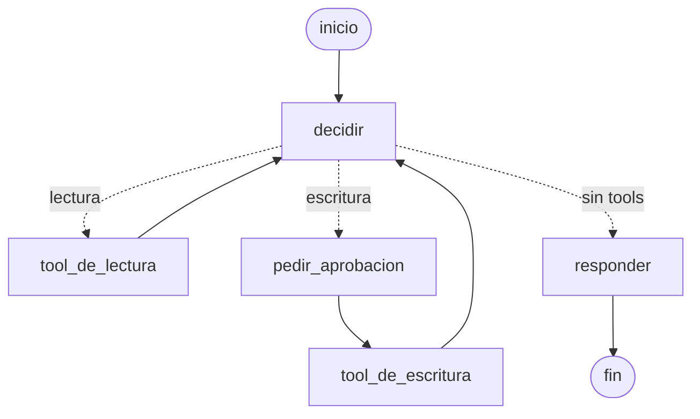

# Agente supervisado · Pre-Entrega 4 (ejemplo)

Proyecto de ejemplo para la **Pre-Entrega 4: Agente con LangGraph, MCP y aprobación humana**.

**Caso ficticio:** soporte de pedidos de la *Distribuidora Los Andes*. El agente, usando
Claude, responde consultas sobre pedidos y políticas, y puede **reprogramar entregas**,
pero solo si una persona lo aprueba.

## Estructura de carpetas

```
agente-supervisado/
├── agente/            El cerebro
│   ├── llm.py         Claude con las tools enlazadas (bind_tools)
│   ├── grafo.py       Grafo de LangGraph: nodos, aprobación humana, memoria
│   ├── models/        Modelos pydantic: estado, aprobaciones, resultados
│   └── tools/         Las manos: tools de LangChain, en read.py y write.py
├── servidor_mcp/      Servidor MCP propio que expone el sistema del cliente
├── sistema_cliente/   El "sistema del cliente" simulado (base SQLite con datos ficticios)
├── ui/                Interfaz web: chat + eventos en vivo + grafo
├── docs/              Políticas (para el RAG) y entregables: conversaciones, grafo, decisiones
├── data/              Bases que genera el proyecto (no se suben al repo)
├── config.py          Configuración: modelo, máximo de pasos, rutas. Lee el .env
├── run_demo.py        Corre las 5 conversaciones de ejemplo de la consigna
├── exportar_grafo.py  Exporta el diagrama del grafo en Mermaid
├── Makefile           Atajos: make setup, make ui, make demo…
└── setup.sh           Instala todo (lo usa make setup)
```

Cada carpeta tiene su propio `README.md` que explica qué hay adentro.

**Cómo se conectan:** la `ui/` (o `run_demo.py`) le pasa el mensaje al grafo de `agente/`.
Claude, con las tools enlazadas (`bind_tools`), responde con texto o pide tools
(`tool_calls`). El grafo ejecuta esas tools de `agente/tools/`; las del servidor MCP leen y
escriben en `sistema_cliente/`. Si una tool es de escritura, el grafo se pausa hasta que una
persona aprueba. El resultado vuelve al modelo, que sigue hasta responder sin pedir tools.



## Cómo correrlo

Requiere Python 3.10 o superior (en Mac: `brew install python@3.12`) y una API key de Anthropic.

```bash
cp .env.example .env     # y pegá tu ANTHROPIC_API_KEY (sin comillas)
make setup               # una sola vez: entorno, dependencias y base del cliente
make ui                  # abre http://localhost:8000
```

Otros comandos: `make demo` (5 conversaciones de ejemplo), `make mcp` (prueba el servidor MCP),
`make grafo` (exporta el Mermaid), `make reset` (vuelve los datos al inicio) y `make help`.

## Qué cubre de la consigna

| Requisito | Dónde está |
|---|---|
| Estado con `mensajes`, `usuario`, `pasos`, `pendiente_aprobacion` | `agente/models/estado.py` (pydantic) |
| Nodos decidir, pedir aprobación, responder y **un nodo por cada tool** | `agente/grafo.py` |
| Bucle con límite configurable y mensaje claro al llegar al máximo | `MAX_PASOS` en `config.py` |
| Estado persistente con `thread_id` | `SqliteSaver` en `agente/grafo.py` |
| Aprobación humana con `interrupt` (aprobada y rechazada) | nodo `pedir_aprobacion`; si se rechaza, la tool no corre y el modelo se lo cuenta al usuario |
| Servidor MCP propio con herramientas tipadas (lectura y escritura) | `servidor_mcp/server.py` |
| Script cliente que lista herramientas y llama a una | `servidor_mcp/probar_cliente.py` |
| Sistema del cliente simulado | `sistema_cliente/seed.py` |
| `buscar_documentos` (tu RAG) como tool con `@tool` | `agente/tools/read.py` |
| 5 conversaciones de ejemplo con traza | `run_demo.py` → `docs/conversaciones/` |
| Grafo exportado en Mermaid | `exportar_grafo.py` → `docs/grafo.mmd` |
| Decisiones y bitácora del asistente | `docs/decisiones.md`, `docs/bitacora_asistente.md` |

> Este proyecto usa `mcp` 2.x, donde `FastMCP` pasó a llamarse `MCPServer`.
